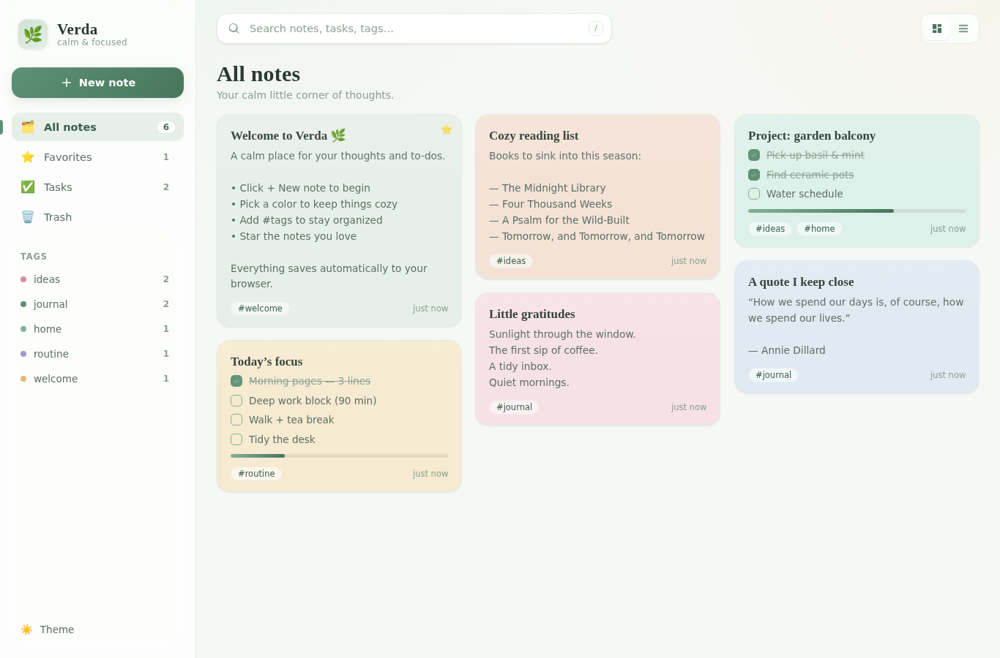

# 🌿 Verdа

A modern, aesthetic note-taking & productivity web app with a calming green
interface — a cozy mix of **Notion**, **Apple Notes**, and Pinterest-style
productivity culture. Minimal, warm, smooth, and visually polished.



## ✨ Features

- **Masonry note board** — Pinterest-style flowing grid of soft pastel cards.
- **Calming green palette** — sage tones, gentle gradients, glassy sidebar,
  soft shadows, and rounded everything.
- **Rich notes** — title + free-flowing body, auto-growing editor.
- **Tasks & checklists** — turn any note into a checklist with live progress
  bars. Press **Enter** in an item to add the next one.
- **Color your notes** — 8 cozy swatches (paper, sage, mint, honey, clay,
  blush, sky, lilac).
- **Tags** — add `#tags`, then filter from the sidebar. Each tag gets a
  consistent color dot.
- **Favorites** — star notes to pin them to the top.
- **Search** — instant search across titles, bodies, checklist items, and tags.
- **Trash** — soft-delete with one-tap **Undo**, restore, or delete forever.
- **Board / List views** — switch layouts from the toolbar.
- **Light & dark themes** — a deep forest-green dark mode included.
- **Fully responsive** — collapsible sidebar on mobile.
- **Auto-save** — everything persists locally in your browser (`localStorage`).
  No account, no server, no tracking.

## ⌨️ Keyboard shortcuts

| Key            | Action                    |
| -------------- | ------------------------- |
| `N`            | New note                  |
| `/`            | Focus search              |
| `Enter`        | (in checklist) add item   |
| `Esc`          | Close editor / dismiss    |

## 🚀 Run it

It's a zero-dependency static app — no build step.

**Option A — just open it**

Open `index.html` directly in your browser.

**Option B — serve it locally** (recommended, avoids any file:// quirks)

```bash
# Python
python3 -m http.server 8000

# or Node
npx serve .
```

Then visit <http://localhost:8000>.

## 🗂️ Project structure

```
index.html   — markup & app shell
styles.css   — the calming green design system + responsive layout
app.js       — state, rendering, editor, tasks, search, persistence
```

## 🎨 Design notes

- Typography pairs **Fraunces** (a soft serif, for headings) with **Inter**
  (for everything else).
- The whole theme is driven by CSS custom properties in `:root` and
  `[data-theme="dark"]`, so re-theming is a few variables away.
- Motion is gentle and respects `prefers-reduced-motion`.

---

## 🏃 Also in this repo: Laufbuch

[`lauf/`](lauf/) — a running tracker (German UI) that reads run screenshots and
watch photos via on-device OCR, saves your sessions and charts your progress.
See [lauf/README.md](lauf/README.md).

---

Made to feel like a calm, green corner of the internet. 🍵
