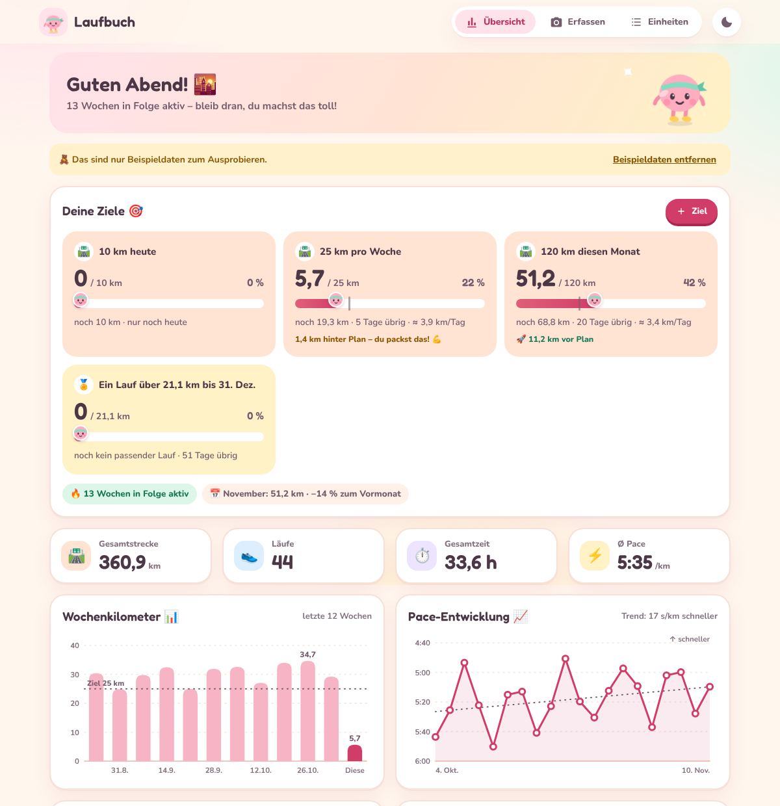
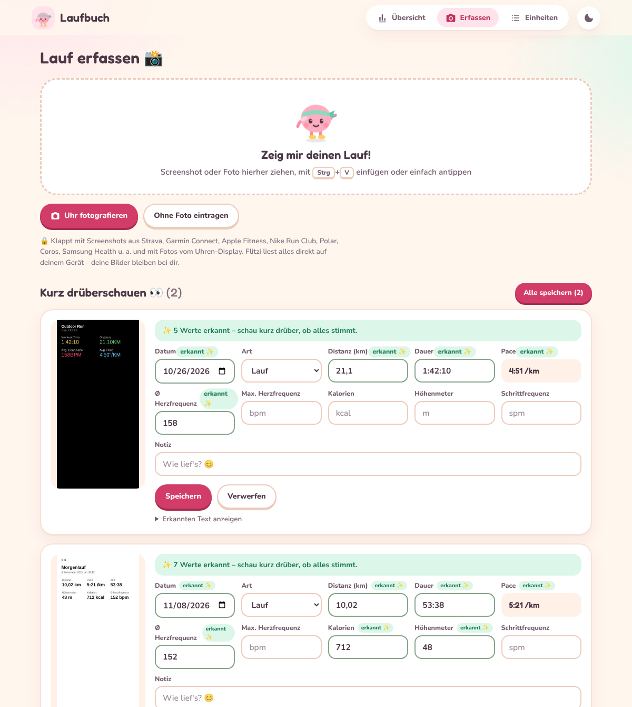
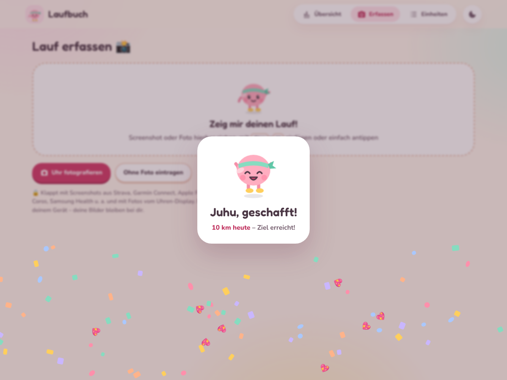
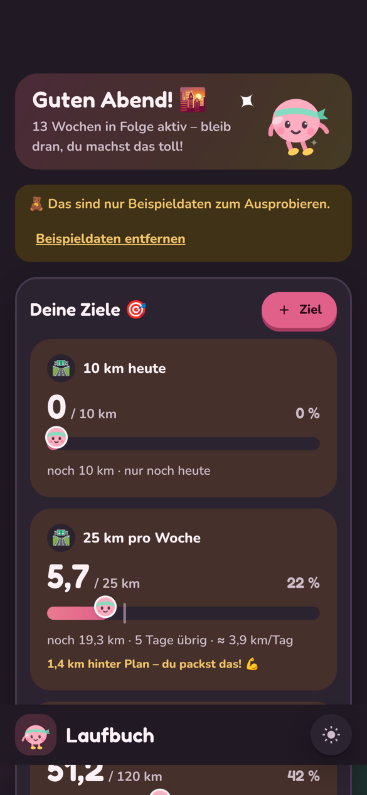

# 🏃 Laufbuch

Eine Lauf-Tracking-Web-App, die **Screenshots und Fotos deiner Läufe automatisch
ausliest**, die Einheiten speichert und deine Fortschritte anzeigt.



## Funktionen

- **Fotoerkennung**: Screenshot oder Foto hochladen, per Drag & Drop ablegen
  oder mit `Strg`+`V` einfügen. Die Texterkennung (Tesseract.js, Deutsch +
  Englisch) läuft komplett im Browser, deine Bilder verlassen das Gerät nicht.
- **Erkannte Werte**: Datum, Distanz, Dauer, Pace, Ø/max. Herzfrequenz,
  Kalorien, Höhenmeter, Schrittfrequenz und die Art des Laufs. Fehlende Werte
  werden berechnet (z. B. Pace aus Distanz und Zeit). Meilen und ft werden
  umgerechnet. Unstimmige Werte werden markiert.
- **Prüfen vor dem Speichern**: Jedes Feld zeigt, ob es *erkannt* oder
  *berechnet* wurde, und lässt sich korrigieren. Mögliche Duplikate werden
  angezeigt. Mehrere Fotos auf einmal → „Alle speichern“.
- **Ziele**: beliebig viele Ziele, einfach in eigenen Worten eingeben, z. B.
  „60 km diese Woche“, „10 km heute“, „3 Läufe pro Woche“, „5 Stunden im
  Monat“, „Halbmarathon bis 31.12.“ oder „8 km morgen“. Unterstützt werden
  Kilometer, Anzahl Läufe, Laufzeit und Einzelläufe. Zeiträume: Tag, Woche,
  Monat, Jahr oder bis zu einem Datum, einmalig oder wiederkehrend. Jede
  Zielkarte zeigt Fortschritt, Rest, verbleibende Tage, nötige km pro Tag und
  ob du **vor oder hinter Plan** liegst. Erreichte Ziele werden beim Speichern
  eines Laufs gefeiert, vergangene Ziele landen im Verlauf.
- **Fortschritt**: aktive Wochen in Folge,
  Monatsvergleich, Gesamtwerte, Wochenkilometer der letzten 12 Wochen,
  Pace-Entwicklung mit Trendlinie und Bestleistungen.
- **Einheiten**: nach Monaten gruppiert, bearbeiten und löschen (mit
  Rückgängig). Export als CSV (für Excel) oder als JSON-Backup inkl. Fotos,
  JSON-Import.
- **Süßes, freundliches Design**: Pastellfarben, runde Formen und Schrift,
  Maskottchen „Flitzi“ (läuft, winkt, jubelt), federnde Animationen,
  Konfetti bei erreichten Zielen, Begrüßung je nach Tageszeit. Animationen
  werden abgeschaltet, wenn das Gerät „Bewegung reduzieren“ eingestellt hat.
- Hell-/Dunkelmodus, für Handys optimiert (schwebende Tab-Leiste, großer
  Kamera-Button).

Getestet mit typischen Layouts von Strava, Garmin Connect, Apple Fitness, Nike
Run Club u. a. (Beschriftung über oder unter dem Wert, mehrspaltig, helle und
dunkle Screenshots).



| Ziel erreicht | Handy, Dunkelmodus |
|---|---|
|  |  |

## Starten

Keine Build-Schritte nötig. Im Repo-Ordner:

```bash
python3 -m http.server 8000
```

Dann <http://localhost:8000/lauf/> öffnen. Für die erste Texterkennung braucht
die App Internet (Tesseract und die Sprachdaten, ca. 15 MB, werden einmalig von
jsDelivr geladen und dann vom Browser zwischengespeichert).

## Daten

Alle Einheiten liegen lokal im Browser (IndexedDB). Es gibt keinen Server und
kein Konto. Wenn du die Browserdaten löschst, sind die Einheiten weg, also
regelmäßig über **Einheiten → Backup** sichern.

## Aufbau

```
lauf/
  index.html          Oberfläche
  styles.css          Design (hell/dunkel, responsiv)
  app.js              Speicher, Fotoaufbereitung, OCR, Statistiken, Diagramme
  parser.js           OCR-Text → Laufdaten (läuft auch in Node)
  goals.js            Ziele: Eingabe in eigenen Worten, Zeiträume, Fortschritt
  tests/              Parser-Tests
```

Tests (OCR-Parser und Ziele):

```bash
node --test lauf/tests/*.test.js
```

## Mögliche nächste Schritte

- Installierbar als App (PWA mit Offline-Cache)
- Optional KI-Bilderkennung für schwierige Fotos (z. B. schräg fotografierte Uhr)
- Synchronisierung zwischen Geräten
